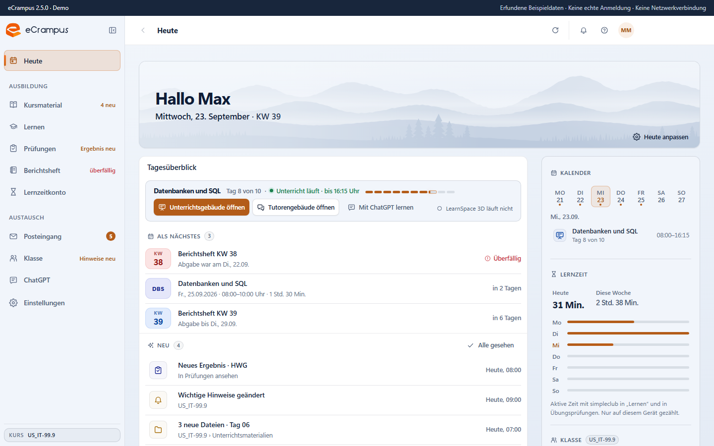

# eCrampus · Browser-Demo

Interaktive Demo der Windows-Anwendung eCrampus in **Version 2.5.0**, ausschließlich mit erfundenen Beispieldaten.

**[Live-Demo öffnen](https://nullframe-sh.github.io/ecrampus-showcase/)**



## Was eCrampus ist

eCrampus ist ein Desktop-Client für den Unterrichtsalltag in meiner Umschulung zum Fachinformatiker für Anwendungsentwicklung bei der WBS GRUPPE. Kursunterlagen, Berichtsheft, Prüfungsergebnisse und Posteingang der Lernplattform stehen in einer Anwendung, Neuigkeiten meldet sie von selbst. eCrampus ist mein eigenständiges Projekt und kein offizielles Angebot der WBS.

Laut integriertem Online-Zähler nutzen 10–12 der 22 Teilnehmenden meines Kurses eCrampus aktiv (Stand Oktober 2026).

## Stand dieser Demo

| | |
| --- | --- |
| Quelle | Veröffentlichte Version 2.5.0 vom 20.10.2026 (Tag `v2.5.0`, Commit `6c66214`) |
| Oberfläche | Original-Renderer der Desktop-Anwendung (React), als eine statische HTML-Datei exportiert |
| Daten | Erfundene Testdaten der UI-Testsuite; Demo-Datum 23.09.2026, Klasse „US_IT-99.9“ |
| Anmeldung | Simuliert; es werden keine Zugangsdaten abgefragt oder verarbeitet |

**Grenzen:** simpleclub und das Lernzeitkonto öffnen sich in der Desktop-Anwendung in eigenen Webansichten; die Demo zeigt an dieser Stelle einen Hinweis. Downloads, Speichern und Senden sind Demo-Aktionen, beim Neuladen beginnt alles von vorn. Der Online-Zähler ist ausgeblendet, weil er in der Demo keine echten Nutzer zeigen kann.

## Bereiche

| Bereich | Inhalt | Bild |
| --- | --- | --- |
| Heute | Tagesüberblick aus bereits geladenen Daten: Unterricht, Als Nächstes, Neu, Kalender, Lernzeit | [hell](docs/screenshots/heute-hell.png) · [dunkel](docs/screenshots/heute-dunkel.png) · [375 px](docs/screenshots/heute-375.png) |
| Kursmaterial | Kurse und Ordner, Dateitabelle, Details und Vorschau | [Bild](docs/screenshots/kursmaterial-hell.png) |
| Lernen | Einstieg in simpleclub mit „Kursmodule hinzufügen“ | [Bild](docs/screenshots/lernen-hell.png) |
| Prüfungen | Anstehende und absolvierte Prüfungen mit Ergebnissen | [Bild](docs/screenshots/pruefungen-hell.png) |
| Berichtsheft | Wochen mit Stunden und Vorbefüllung; eigene Einträge bleiben unangetastet | [Bild](docs/screenshots/berichtsheft-hell.png) |
| Posteingang | Nachrichten der Lernplattform | [Bild](docs/screenshots/posteingang-hell.png) |
| Klasse | Mitglieder, Informationen und Feedback | [Bild](docs/screenshots/klasse-hell.png) |
| ChatGPT | Chat der Lernplattform mit Fragevorschlägen zum aktuellen Modul | [Bild](docs/screenshots/chatgpt-hell.png) |
| Einstellungen | Eigene Seite für Darstellung, Konto und Daten | [Bild](docs/screenshots/einstellungen-hell.png) |

Hilfe gibt es über F1 oder das Fragezeichen oben rechts, dazu einen geführten Rundgang.

## Datenschutz und Sicherheit

- Ausschließlich erfundene Namen, Kurse, Nachrichten und Noten. Die Versionshinweise der App nennen im Original die echte Kursgruppe; im Export ist sie durch die Testklasse ersetzt.
- Die Seite lädt nichts nach: Skripte, Stile, Bilder und Schriften sind eingebettet, und die Content Security Policy verbietet Netzwerkverbindungen (`connect-src 'none'`).
- Kein Electron-Hauptprozess, keine Source Maps. Der Quellcode der Desktop-Anwendung ist nicht öffentlich.

## Prüfung

Geprüft am 28.10.2026 in Chromium: alle zehn Bereiche über die Seitenleiste, helles und dunkles Farbschema, Breiten 1440, 900 und 375 Pixel. Ergebnis: keine Konsolenfehler, keine Netzwerkanfragen, kein seitliches Überlaufen. Einzelheiten in [docs/validation-2.5.0.md](docs/validation-2.5.0.md). Quell-Commit und SHA-256 des Exports stehen in `demo-version.json`.

## Technik

| | |
| --- | --- |
| Desktop-Anwendung | Electron, React, TypeScript, electron-vite, Jest, electron-builder, electron-updater |
| Demo | Vite-Build des Renderers mit den Mock-Daten der UI-Testsuite, eingebettet in `index.html` |

## Meine Arbeit an eCrampus

Ich lege fest, welche Funktionen es gibt und wie sie sich bedienen, und arbeite Rückmeldungen aus dem Kurs ein. Fehler verfolge ich über Konsole, Logdateien und Entwicklerwerkzeuge bis in den Code. Den Code erstelle ich mit KI-Unterstützung und prüfe jede neue Version mit automatisierten Tests sowie einem Installations- und Upgrade-Test, bevor ich sie über meinen eigenen Update-Server veröffentliche.

## Lokal öffnen

`index.html` herunterladen und im Browser öffnen. Ein Webserver ist nicht nötig.

## Export neu erzeugen

Mit einem sauberen privaten Checkout am Commit `6c66214` und installierten Abhängigkeiten:

```sh
node tools/build-demo.mjs /pfad/zum/privaten/checkout
```

Danach Navigation, Screenshots und Netzwerkfreiheit erneut im Browser prüfen. Der Stand 2.3.0 bleibt über den Tag `archive/showcase-2.3.0` wiederherstellbar.

## Kontakt

**Philipp Schott**, Umschulung zum Fachinformatiker für Anwendungsentwicklung  
[nullframe.sh](https://nullframe.sh) · [phsc@nullframe.sh](mailto:phsc@nullframe.sh) · [github.com/nullframe-sh](https://github.com/nullframe-sh)
