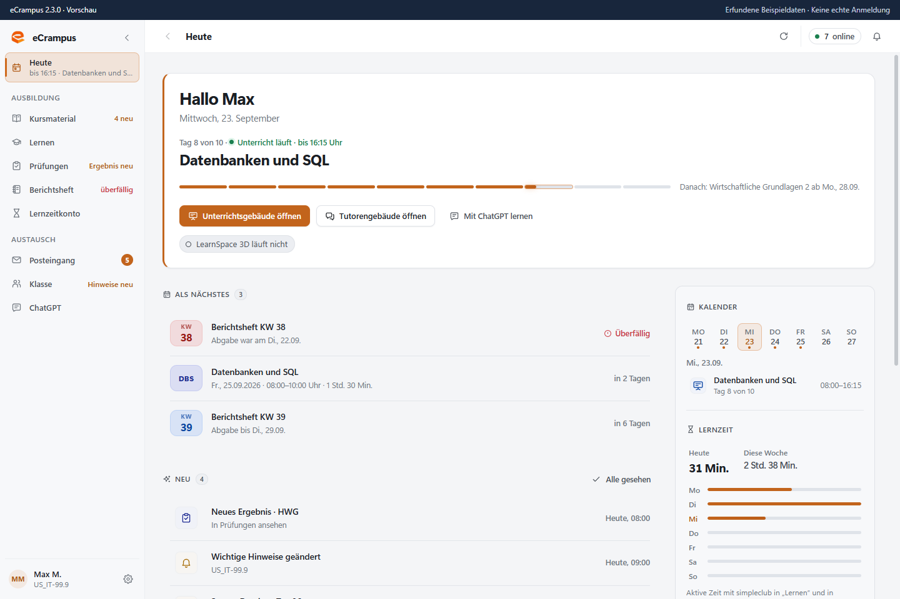
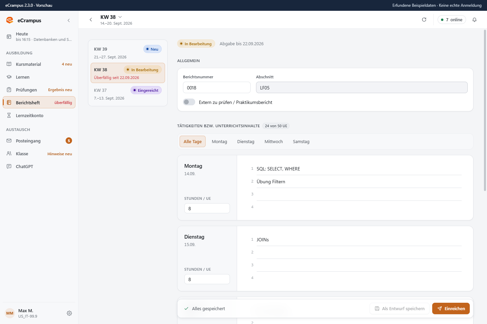
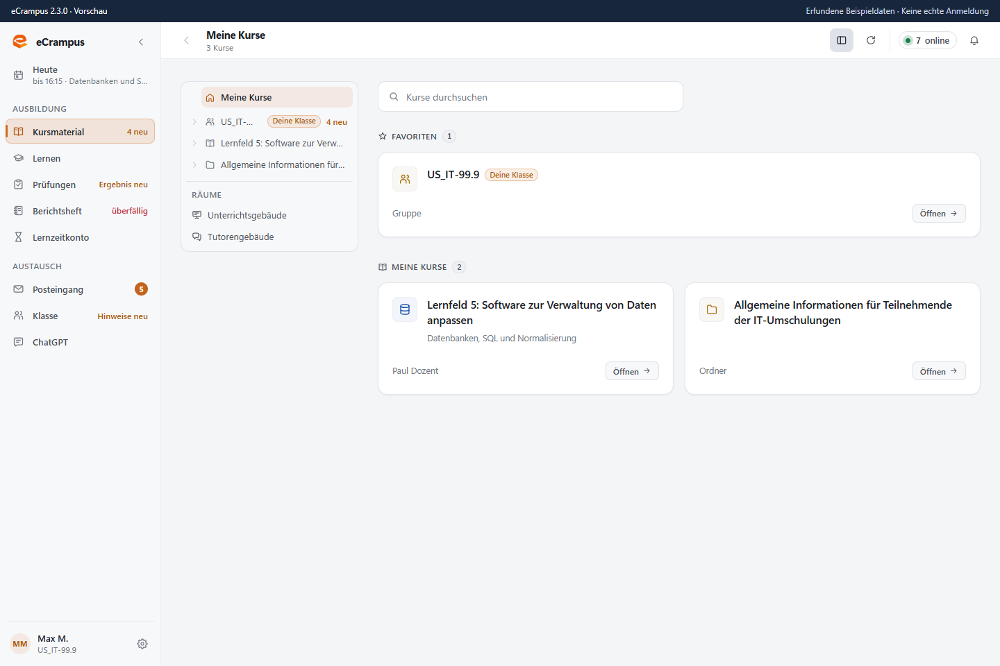

# eCrampus – Browser Showcase

> **Interaktive Demo der Benutzeroberfläche von eCrampus mit fiktiven Daten.**  
> 🔗 **[Zur Live-Demo auf GitHub Pages](https://nullframe-sh.github.io/ecrampus-showcase/)**

## Aktueller Demo-Stand

Diese Demo zeigt die **Vorschau auf v2.3.0**, basierend auf dem lokal committeten Entwicklungsstand `492068c1212760b70edf774e25b44741d01332a0` aus `release/2.3.0`. Sie stellt keine fertig veröffentlichte Desktop-Version dar.

Die Original-Oberfläche enthält die gruppierte Navigation, die Lernzeitübersicht, den simpleclub-Einstieg unter „Lernen“ und das Lernzeitkonto. Die externen Webansichten von simpleclub und Lernzeitkonto werden im Browser durch einen erklärenden Hinweis vertreten. Alle übrigen Beispieldaten stammen aus dem fiktiven Renderer-Testbestand. Die Demo-Uhr steht auf dem 23. September 2026, passend zu diesen Beispielen.

Der Export bleibt eigenständig und blockiert Netzwerkverbindungen per Content Security Policy. Die genaue Quellversion und der SHA-256-Wert des Exports stehen in `demo-version.json`.

---

## 📌 Über dieses Repository

Dieses Repository enthält das öffentlich zugängliche **Browser-Showcase** für **eCrampus**, eine Desktop-Anwendung, die während meiner Umschulung zum *Fachinformatiker für Anwendungsentwicklung* bei WBS TRAINING AG entstanden ist.

### ⚠️ Wichtiger Hinweis zu Daten und Anmeldung
* **Reine Mock-Daten:** Die in der Demo gezeigten Kurse, Kalendereinträge, Nachrichten, Namen und Noten sind rein fiktiv.
* **Simulierte Sitzung:** Der Button *„Bei eCampus anmelden“* startet eine lokale Demo-Sitzung. Es besteht **keine** Verbindung zum eCampus oder zu Microsoft-Diensten; es werden keinerlei echte Zugangsdaten benötigt oder verarbeitet.
* **Abgrenzung zum Desktop-Client:** Die vollständige Desktop-Anwendung läuft auf Basis von Electron mit lokaler Systemintegration. Der Quellcode des Desktop-Clients bleibt privat; dieses Repository dient der Demonstration von UI-Design, Informationsarchitektur und Bedienkonzept im Webbrowser.

---

## 💡 Problemstellung & Lösung

### Das Problem
Im alltäglichen Unterricht fallen viele verschiedene Informationsquellen und Aufgaben an:
* Ständiges Wechseln zwischen zahlreichen Browser-Tabs für Kursordner, Lerninhalte, Termine, Prüfungen und Nachrichten.
* Aufwendige wöchentliche Berichtsheftführung mit wiederkehrenden Dokumentationsschritten.
* Fehlende zentrale Übersicht über den aktuellen Tag und anstehende Fristen.

### Die Lösung: eCrampus
Ein zentraler Desktop-Client, der die verstreuten Bereiche an einer gemeinsamen Anlaufstelle zusammenführt:
* **Tagesübersicht („Heute“):** Zeigt den laufenden Unterrichtstag im Modul, anstehende Termine, Fristen und neue Unterrichtsmaterialien auf einen Blick.
* **Berichtsheftführung:** Direkte Erfassung der Ausbildungstage mit Stunden- und Inhaltseingabe sowie Vorbefüllung aus Tageszusammenfassungen.
* **Kursmaterial & Lerninhalte:** Strukturierter Einstieg in Modulunterlagen und Lernthemen ohne Tab-Chaos.
* **Prüfungen & Benachrichtigungen:** Überblick über anstehende Modulprüfungen, Noten und wichtige Mitteilungen.

---

## 🛠️ Technologie-Stack

* **Desktop-Anwendung:** Electron, React, TypeScript
* **Showcase-Repository:** Statischer Web-Export der Original-Oberfläche (Single-Page HTML-Bundle mit React, CSS und eingebetteten Mock-Handlern)

---

## 📸 Eindrücke aus der Benutzeroberfläche

### 1. Tagesübersicht („Heute“)
Zentraler Ausgangspunkt für den Unterrichtstag mit Fortschrittsanzeige, Schnellzugriffen und Benachrichtigungen.


### 2. Berichtsheft-Editor
Übersichtliche Erfassung nach Wochentagen, automatische Stundenberechnung und Funktion zur Vorbefüllung.


### 3. Kursmaterialien & Module
Schneller Überblick über Kurse, Unterlagen und aktuelle Unterrichtsinhalte.


---

## 👤 Mein Beitrag & Arbeitsweise

Ich absolviere seit Mai 2026 eine Umschulung zum Fachinformatiker für Anwendungsentwicklung. Mein Beitrag zu eCrampus umfasst:

* **Bedarfsanalyse:** Erkennen konkreter Reibungspunkte und organisatorischer Hürden im täglichen Unterrichtsablauf.
* **Anforderungs- und Interface-Design:** Konzeption der Workflows, Informationsarchitektur, Navigation sowie der visuellen Gestaltung (einschließlich Light- und Dark-Mode).
* **KI-gestützte Implementierung:** Umfangreiche Umsetzung des Codes unter gezieltem Einsatz von KI-Tools bei schrittweisem Aufbau eigener Programmierkenntnisse.
* **Fehlersuche & Iteration:** Manuelles Testen, Lesen von Logs und Fehlermeldungen, systematisches Eingrenzen von Problemen und iterative Weiterentwicklung basierend auf praktischem Feedback aus der Kursgruppe.

> **Transparenz zur Nutzung:**  
> Nach meiner eigenen Schätzung (Stand Oktober 2026) wird eCrampus im Kurs (22 Teilnehmer) von etwa **10–12 Teilnehmern täglich** genutzt. Dies basiert auf persönlichem Feedback und Rückmeldungen im Kurs, nicht auf automatisierter Telemetrie.

---

## 💻 Demo lokal ausführen

Da das Showcase als vollständig in sich geschlossene Datei aufgebaut ist, sind keine Installationsschritte erforderlich:

1. Repository klonen:
   ```bash
   git clone https://github.com/nullframe-sh/ecrampus-showcase.git
   cd ecrampus-showcase
   ```

2. `index.html` direkt im Browser öffnen:
   * **Doppelklick** auf `index.html` oder
   * über einen lokalen Webserver ausführen (empfohlen zur Vermeidung von Browser-Restriktionen bei lokalen Dateien):
     ```bash
     # Mit Python 3:
     python -m http.server 8080

     # Oder mit Node.js:
     npx serve .
     ```
   Anschließend `http://localhost:8080` bzw. die angezeigte URL im Browser öffnen.

---

## 📬 Kontakt

**Philipp Schott**  
Umschüler zum Fachinformatiker für Anwendungsentwicklung (WBS TRAINING AG)  
* Portfolio: [nullframe.sh](https://nullframe.sh)  
* E-Mail: [phsc@nullframe.sh](mailto:phsc@nullframe.sh)  
* Profil & Case Study: [github.com/nullframe-sh](https://github.com/nullframe-sh)

## Export aktualisieren

Mit dem privaten Quell-Checkout am oben genannten Commit und dessen installierten Abhängigkeiten:

```sh
node tools/build-demo.mjs /pfad/zum/privaten/checkout
```

Der Export prüft den Quell-Commit und unveränderte versionierte Dateien. Er bündelt ausschließlich die Browser-Oberfläche und fiktive Testdaten, ohne Source Maps oder den Electron-Hauptprozess. Anschließend müssen Navigation, Anmeldung, Screenshots und die Netzwerkfreiheit erneut im Browser geprüft werden.
